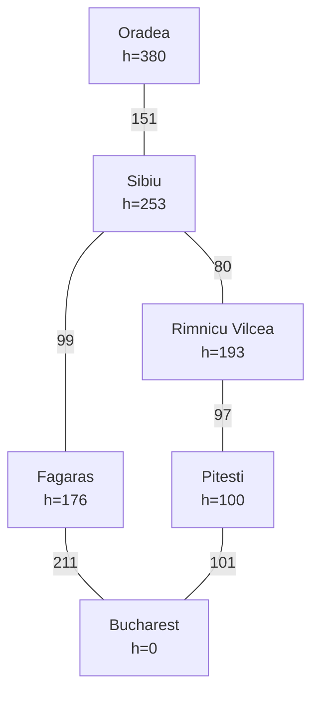

# Reporte Ejercicio 1 - Búsqueda Informada en el Mapa de Rumania

## 1. Ciudades elegidas y Subgrafo
Evaluaremos la ruta de **Oradea** a **Bucharest**. Los algoritmos informados muestran diferentes resultados dependiendo de si consideran o no el costo acumulado de la ruta.

Heurística utilizada: **distancia en línea recta a Bucharest** (Tabla AIMA), que es admisible y consistente.



## 2. Resultados por Algoritmo

| Algoritmo | Depth (saltos) | Costo (km) | Nodos Expandidos | Nodos Generados | Ruta |
| :---: | :---: | :---: | :---: | :---: | --- |
| **Greedy** | 3 | 461 km | 3 | 9 | Oradea, Sibiu, Fagaras, Bucharest |
| **A\*** | 4 | 429 km | 5 | 15 | Oradea, Sibiu, Rimnicu Vilcea, Pitesti, Bucharest |

## 3. Análisis de las Búsquedas

**¿A* encontró el camino de menos km? ¿Greedy coincidió o se desvió?**
A* sí encontró el camino óptimo en distancia de 429 km. Greedy se desvió del camino óptimo, encontrando una ruta más corta en términos de saltos pero con mayor costo (461 km).

**¿Por qué Greedy puede devolver un camino más caro aunque `h` sea admisible?**
Greedy ordena los nodos en su frontera guiándose exclusivamente por el valor heurístico $h(n)$, es decir, evaluando qué tan cerca *parece* estar el nodo de la meta, pero ignorando por completo el costo acumulado $g(n)$ para llegar allí. En esta ruta, estando en Sibiu, Greedy prefirió expandir hacia Fagaras ($h=176$) en lugar de Rimnicu Vilcea ($h=193$) porque Fagaras está aparentemente más cerca en línea recta, a pesar de que el camino real por carretera termine siendo más largo y costoso.

**En el camino de A*, ¿`f` tiende a no disminuir a lo largo de la ruta?**
Así es. Al revisar los valores de $f(n) = g(n) + h(n)$ en el camino de A*, obtenemos:
- Oradea: $f = 0 + 380 = 380$
- Sibiu: $f = 151 + 253 = 404$
- Rimnicu Vilcea: $f = 231 + 193 = 424$
- Pitesti: $f = 328 + 100 = 428$
- Bucharest: $f = 429 + 0 = 429$

Al ser la heurística de distancia en línea recta un estimador *consistente*, el valor calculado para $f(n)$ es monótonamente no decreciente a lo largo de cualquier camino. Nunca disminuye; en cambio, aumenta gradualmente conforme se sustituye la estimación heurística optimista por los costos reales de los tramos hasta igualar el costo exacto al llegar al objetivo.

## 4. Evidencias de Ejecución

**Heurísticas hacia Bucharest:**
```text
Heuristic: straight-line distance to Bucharest (AIMA table)

  h(n)  city
      0  Bucharest  <- goal
    100  Pitesti
    160  Craiova
    176  Fagaras
    193  Rimnicu Vilcea
    253  Sibiu
    329  Timisoara
    366  Arad
    374  Zerind
    380  Oradea  <- start
```

**Ejecución Greedy:**
```text
Algorithm: Greedy best-first search
Problem:   Oradea → Bucharest
Heuristic: straight-line distance to Bucharest (AIMA table)
Status:    success
Path:      Oradea → Sibiu → Fagaras → Bucharest
Depth:     3 roads
Cost:      461 km

  city                  g     h     f
  Oradea                   0   380   380
  Sibiu                  151   253   404
  Fagaras                250   176   426
  Bucharest              461     0   461

Expanded:  3 nodes
Generated: 9 nodes
Frontier:  max size 4
```

**Ejecución A*:**
```text
Algorithm: A* search
Problem:   Oradea → Bucharest
Heuristic: straight-line distance to Bucharest (AIMA table)
Status:    success
Path:      Oradea → Sibiu → Rimnicu Vilcea → Pitesti → Bucharest
Depth:     4 roads
Cost:      429 km

  city                  g     h     f
  Oradea                   0   380   380
  Sibiu                  151   253   404
  Rimnicu Vilcea         231   193   424
  Pitesti                328   100   428
  Bucharest              429     0   429

Expanded:  5 nodes
Generated: 15 nodes
Frontier:  max size 5
```
