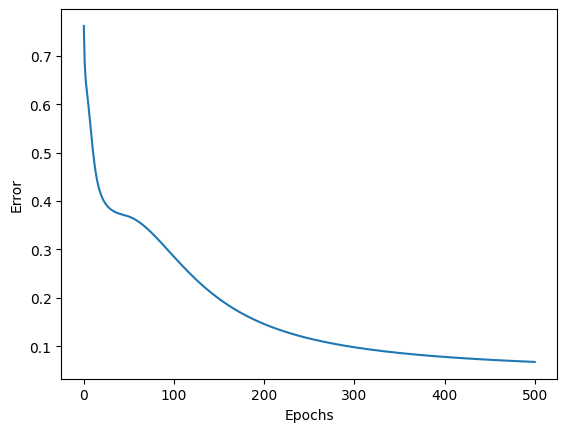
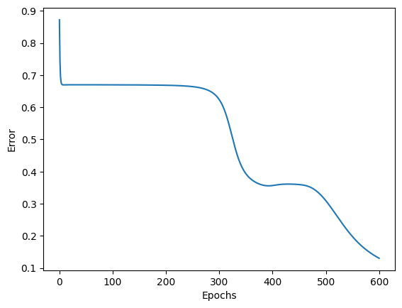
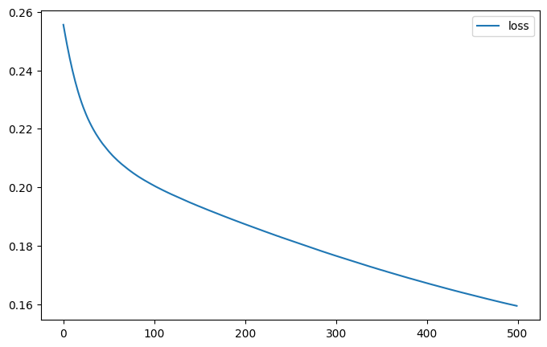
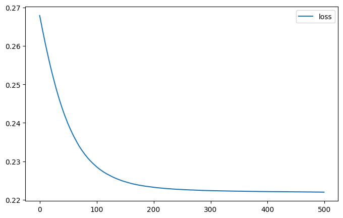
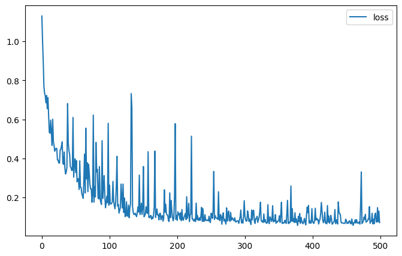
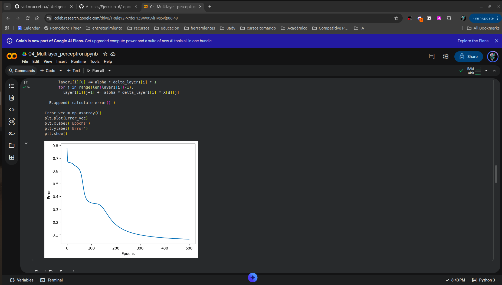
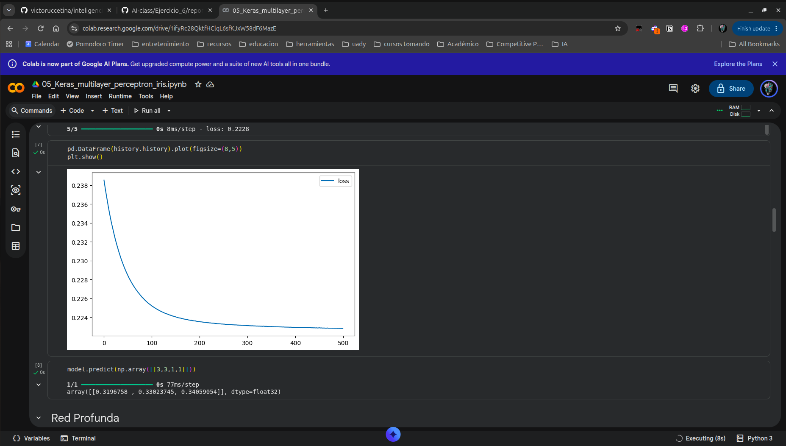

# Reporte Ejercicio 1 — Más capas en el perceptrón multicapa (Iris)

## 1. Análisis de las Redes

**¿Bajar más el error al añadir dos capas, o se estancó / empeoró? ¿Igual en NumPy y en Keras?**

Al meterle dos capas extra (pasando del topology $4 \times 3 \times 3$ a $4 \times 3 \times 3 \times 3 \times 3$), el error no bajó nada: se estancó feo y el entrenamiento empeoró. En la red chica de 2 capas el error cae rápido en pocas épocas, pero al meter 4 capas la convergencia se frena en seco y la pérdida se queda atorada en una meseta altísima durante las 500 épocas. 

Pasó exactamente lo mismo tanto en la versión a mano con NumPy como en Keras, demostrando que no es bronca de código ni de librería, sino el clásico cuello de botella al apilar sigmoides.

---

**¿Las curvas de la notebook 01 y de Keras se parecen con la misma topología? Si no, ¿qué diferencias de implementación podrían explicarlo?**

Siguen la misma tendencia general, pero las curvas no son idénticas por diferencias directas en cómo procesan los datos:

1. **Batch size y optimización:** En NumPy se hace SGD online puro (`batch_size=1`), procesando muestra por muestra. Keras por default entrena con mini-batches de 32 (`batch_size=32`), por lo que el gradiente viene promediado y su curva sale mucho más limpia y suave.
2. **Shuffle:** En NumPy recorremos el arreglo en orden fijo (procesando primero todas las muestras de una clase y luego las de otra), lo que mete ruido y sesgo por bloques. Keras baraja los datos al azar en cada época.
3. **Init de pesos:** NumPy inicializa con uniforme en $[-0.5, 0.5]$ y bias aleatorio. Keras usa *Glorot Uniform* (Xavier) y clava los bias en ceros.
4. **Escala del Loss:** Keras promedia el MSE entre las 3 neuronas de salida, mientras que en NumPy calculamos el error cuadrático acumulado directo, cambiando la escala del eje Y.

---

**Con sigmoides apiladas y MSE, ¿tiene sentido que una red más profunda no aprenda mejor en Iris? Relaciónalo con lo que viste en las gráficas.**

Tiene todo el sentido del mundo:

1. **Vanishing Gradient:** La derivada de la sigmoide $\sigma'(z) = \sigma(z)(1 - \sigma(z))$ topa en un máximo de $0.25$. Cuando encadenas 4 capas, la regla de la cadena multiplica esas derivadas hacia atrás ($\le 0.25^4 \approx 0.0039$). El gradiente que llega a las primeras capas es prácticamente cero, así que los pesos de entrada casi no se actualizan y la red no aprende.
2. **Saturación con MSE:** Si una neurona se satura mandando salidas pegadas a 0 o 1, su derivada se anula y el gradiente deja de corregir el error.
3. **El problema es chico:** Iris tiene apenas 150 filas y 4 features; las clases son prácticamente separables de forma lineal. Meterle capas a lo loco no aporta nada y solo mete fricción numérica y problemas para optimizar.
4. **Comportamiento en gráficas:** Se ve clarísimo: la de 2 capas aprende constante, mientras que la profunda se plancha en una línea horizontal sin bajar casi nada.

---

## 2. Evidencias de Ejecución

### Notebook 01 — NumPy (Implementación a mano)
- **Red Original ($4 \times 3 \times 3$):**  
  
- **Red Profunda ($4 \times 3 \times 3 \times 3 \times 3$):**  
  

### Notebook 02 — Keras / TensorFlow
- **Red Original ($4 \times 3 \times 3$):**  
  
- **Red Profunda ($4 \times 3 \times 3 \times 3 \times 3$):**  
  

### Reto Opcional — ReLU + Softmax + Categorical Crossentropy
- **Red Profunda optimizada con ReLU y Softmax:**  
  

### Entorno de ejecución en Colab
- **Evidencia Notebook 01 (NumPy):**  
  
- **Evidencia Notebook 02 (Keras):**  
  
