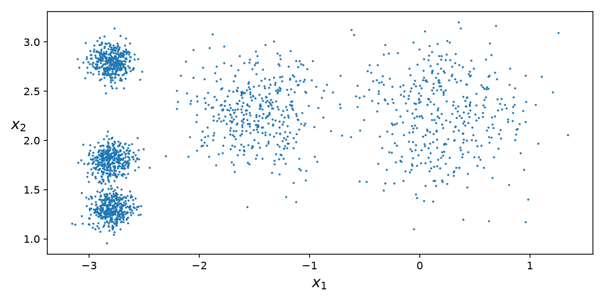
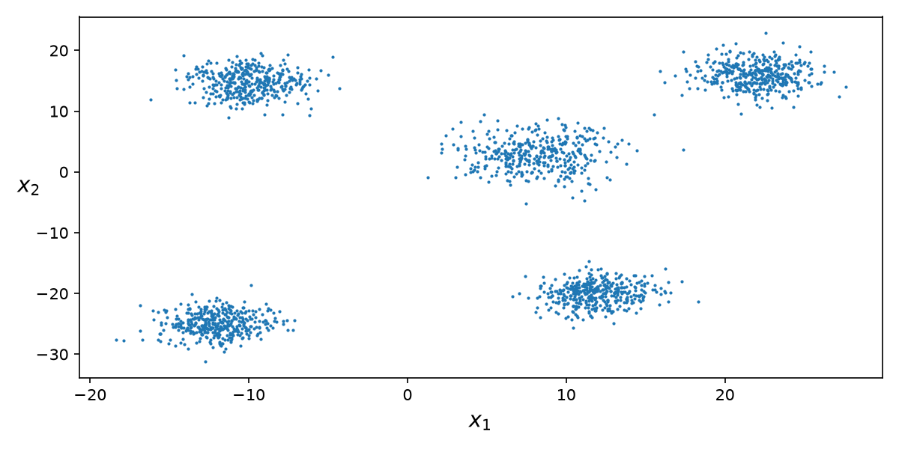
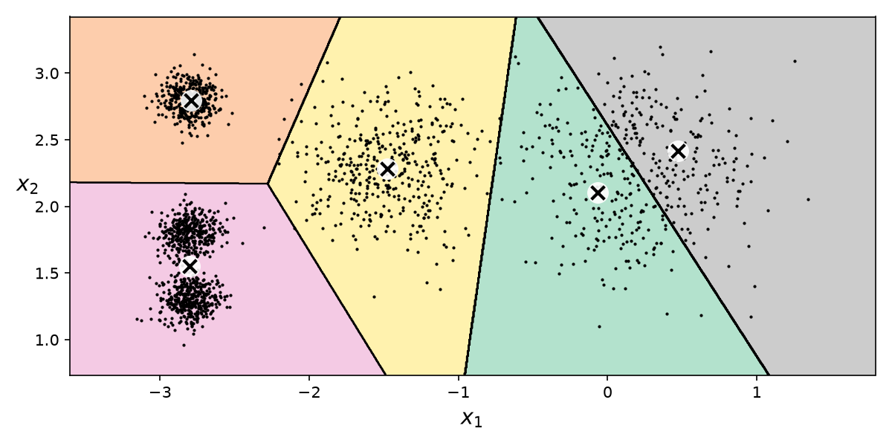
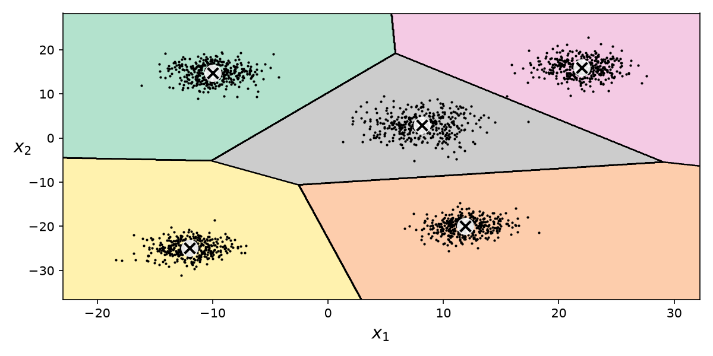
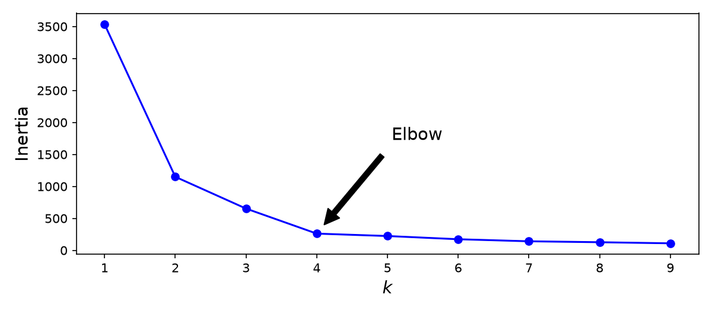
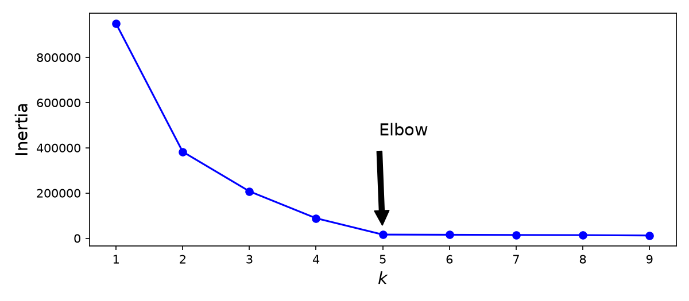
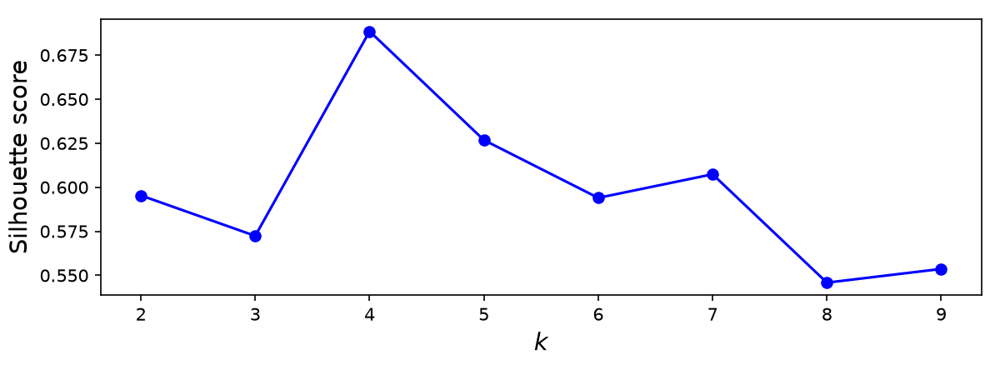
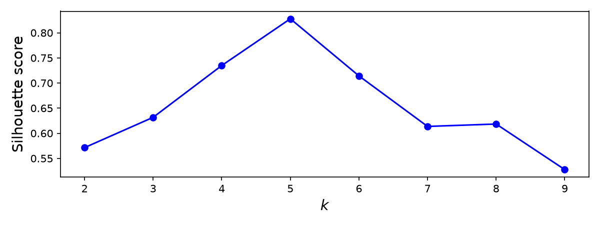

# Reporte Ejercicio 1 — Separar los blobs y volver a elegir $k$

## 1. Análisis de Resultados

**En los datos de Géron, ¿por qué el codo "prefiere" $k = 4$ si `make_blobs` usó 5 centros?**

En el dataset original de Géron, tres de los cinco clusters están amontonados verticalmente en la misma coordenada horizontal ($x = -2.8$), con centros en $y \in \{1.8, 2.8, 1.3\}$ y con una desviación estándar minúscula ($\sigma = 0.1$). Al estar prácticamente pegados, la distancia intra-cluster entre ellos es insignificante comparada con la distancia global hacia los otros dos grupos más lejanos.

Desde el punto de vista de la inercia (suma de distancias al cuadrado a sus centroides):
- Pasar de $k = 3$ a $k = 4$ parte un grupo grande y lejano, reduciendo drásticamente la inercia.
- Pero pasar de $k = 4$ a $k = 5$ solo separa dos nubes densas que ya están casi encima una de la otra. Como esa separación apenas reduce la suma de distancias al cuadrado, la curva de inercia casi no se inmuta a partir de $k=4$, haciendo que el codo se marque claramente en **$k = 4$** e ignorando el quinto centro.

---

**Con tus blobs separados, ¿el codo y la silueta coinciden en el mismo $k$? ¿Ese $k$ es 5?**

Sí, coinciden de forma exacta y contundente en **$k = 5$**.

Al redistribuir los centros en coordenadas lejanas y bien distribuidas:
```python
blob_centers = np.array([
    [-10.0,  15.0],
    [  8.0,   3.0],
    [ 12.0, -20.0],
    [ 22.0,  16.0],
    [-12.0, -25.0]
])
blob_std = np.array([2.0, 2.5, 1.8, 2.0, 1.8])
```
Cada uno de los 5 grupos forma una cuenca de densidad aislada en el plano 2D:
1. **Método del Codo:** La inercia se desploma de forma sostenida (de ~949,816 en $k=1$ hasta 16,227 en $k=5$). Al pasar a $k=6$, la inercia apenas baja a 15,450. La curva quiebra de golpe y forma un ángulo limpio justo en **$k = 5$**.
2. **Coeficiente de Silueta:** En la versión original el score titubeaba entre 4 y 5. Ahora, alcanza su máximo global evidente en **$k = 5$ con $0.828$** (mientras que para $k=4$ es $0.735$ y para $k=6$ cae a $0.714$).

---

**Si el codo sigue en 4, ¿qué te falta mover (distancia entre centros vs. `blob_std`)?**

K-means distingue clusters cuando la distancia euclidiana entre sus centros $c_i, c_j$ es significativamente mayor que la dispersión de sus puntos, típicamente $\|c_i - c_j\| \gg 2(\sigma_i + \sigma_j)$. 

Si el codo se queda en 4, significa que todavía hay dos nubes fusionadas que el algoritmo minimiza tratándolas como un único cluster compuesto. Para corregirlo, se necesita:
1. **Aumentar la separación entre centros:** Mover las coordenadas $(x, y)$ para que no compartan proyecciones ni ejes comunes.
2. **Ajustar `blob_std`:** Si las desviaciones son muy grandes respecto a la separación, las colas de las campanas gaussianas se solapan y K-means las absorbe bajo un solo centroide promedio.

---

## 2. Evidencias de Ejecución

### Comparativa Lado a Lado (Original vs Modificado)

| Métrica / Gráfica | Corrida Original (Géron) | Corrida Modificada (Blobs Separados) |
| :--- | :---: | :---: |
| **Distribución de Puntos (Scatter)** |  |  |
| **Fronteras de Decisión (Voronoi $k=5$)** |  |  |
| **Método del Codo (Inercia)** |  |  |
| **Coeficiente de Silueta** |  |  |
